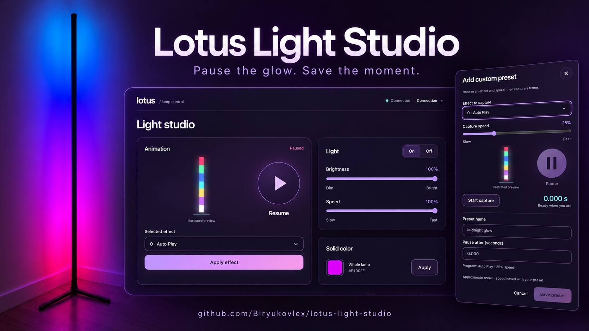

# Lotus Light Studio



A local Bluetooth control app for Lotus Lamp–compatible lights, with **Pause** at its heart. Run it as a **Mac app** or a **web app** in your browser, on macOS or Windows.

## What you can do

- Control power, brightness, animation speed and whole-lamp RGB color.
- Browse 213 built-in programs in **Presets → Default**, with search, categories and illustrated previews.
- **Pause** an effect on a frame you like, then resume it.
- Use the interface in **English or Spanish** (language picker in the header; follows your browser language by default).
- Create **Custom presets**: choose an effect and capture speed, pause, name and save. Replay automatically pauses after the saved time at the saved speed. Edit or delete recipes locally.

<details>
<summary>App screenshots</summary>


</details>

## Run locally

Requires Bluetooth and **Python 3.11+ or uv**. Both options use the same controls, saved lamp and custom presets, with no cloud account or remote assets.

```sh
git clone https://github.com/Biryukovlex/lotus-light-studio.git
cd lotus-light-studio
```

### Web app

Double-click **Launch Lotus Lamp.command**, or run:

```sh
open "Launch Lotus Lamp.command"
```

First launch installs the Python dependencies and opens **http://127.0.0.1:8420**. Keep its terminal open; Ctrl+C stops the server and releases Bluetooth.

### Windows

Requires Windows 10/11 with Bluetooth LE and **Python 3.11+** (from [python.org](https://www.python.org/downloads/)) **or uv**.

Double-click **Launch Lotus Lamp.bat**. First launch creates `.venv`, installs the pinned dependencies from `requirements-app-windows.lock` and opens **http://127.0.0.1:8420**. Keep the console window open; Ctrl+C stops the server and releases Bluetooth.

If the lamp does not appear in the scan, turn Bluetooth on in Windows Settings and make sure the lamp is not connected to the phone app. Do not pair the lamp in Windows Settings; the app connects to it directly.

### Windows app (.exe)

A native window with a system-tray icon, built with pywebview (WebView2) and PyInstaller:

```powershell
powershell -ExecutionPolicy Bypass -File scripts\build-windows.ps1
```

This creates `dist\Lotus Light Studio\Lotus Light Studio.exe` from the hash-pinned `requirements-desktop-windows.lock` (in a separate `.venv-build`), a **Desktop shortcut**, and a **Startup shortcut** that launches the app minimized to the tray when you sign in. A lamp saved by the web launcher is copied over once.

- Closing the window keeps the app in the tray so SignalRGB sync continues. **Exit** in the tray menu stops it and releases Bluetooth.
- Opening it again (shortcut or `.exe`) shows the running window instead of starting a second copy.
- If SignalRGB sync was on when the app last ran, it turns back on at launch and reconnects the saved lamp.
- Data and log: `%LOCALAPPDATA%\Lotus Light Studio`. Remove the shortcuts with `scripts\install-windows-shortcuts.ps1 -Remove`.

### SignalRGB sync (Windows)

Let [SignalRGB](https://signalrgb.com) effects color the lamp alongside the rest of your RGB setup.

1. Copy the `signalrgb/LotusLamp` folder to `Documents\WhirlwindFX\Plugins\LotusLamp` (use `OneDrive\Documents\…` if your Documents folder is synced) and restart SignalRGB. **Lotus Lamp** appears under Devices; no IP needs to be entered.
2. Start Lotus Light Studio, connect the lamp and switch **SignalRGB sync** on.
3. In SignalRGB → Layouts, place the Lotus Lamp where you want it to sample the effect.

How it works: the plugin sends the lamp's color as a 9-byte UDP packet (`LOTUS`, version `1`, R, G, B) to **127.0.0.1:8421**; the app forwards it over Bluetooth LE.

- The lamp shows **one color at a time**. Effects that move along a strip become a single color changing over time, taken from where the lamp sits on the canvas.
- At most **15 updates per second** reach the lamp; faster frames are merged into the latest one and repeated colors are not resent.
- The receiver listens on this PC only. Use `--signalrgb-port` (and the port field on the plugin's Network card) if 8421 is taken.
- Any manual control (color, effect, brightness, preset, scan, disconnect) turns sync off. If Bluetooth drops while syncing, the app reconnects automatically (waiting 2 s, then up to 30 s between attempts).
- The plugin's **Lighting Mode** (Canvas/Forced) and **Shutdown Color** settings work like other SignalRGB devices.

Full guide, packet format, shutdown behavior and troubleshooting: [SignalRGB sync](docs/SIGNALRGB.md).

### Mac app

After the first-time setup above, stop the web server with Ctrl+C and build the native app. Building requires **macOS 12+ and Xcode Command Line Tools**:

```sh
.venv/bin/python scripts/build_macos_launcher.py --install-path "$HOME/Desktop/Lotus Light Studio.app"
```

Double-click **Lotus Light Studio.app** on your Desktop. It starts the server and opens the studio in its own window, without a terminal or coding assistant. Closing the window or Cmd+Q stops the server it started. An already-running server is reused and remains running when the window closes.

The Mac app is locally built and signed, and uses this checkout's Python environment. Keep the project folder in place; rebuild if you move it. [Launcher details](LOCAL_APP.md#desktop-launcher).

For either option, allow Bluetooth access when asked, close the lamp's phone app, and connect your lamp.

## Compatibility and limits

Tested on macOS and Windows 11 with a **Tyute SSG-500 / MELK-OA10**. Other controllers need validation. Pause is experimental; timed preset recall is approximate, and previews illustrate effect families. Arbitrary segment colors, custom palettes and firmware flashing are not supported. [Setup and details](LOCAL_APP.md).

## Help extend it

Developers are welcome! Add controller support, improve effect previews, investigate the protocol, or extend the controls. Open an issue or pull request, and include your lamp model and test evidence. See the [developer guide](docs/DEVELOPMENT.md) and [protocol notes](docs/PROTOCOL.md).

Developed by [biryukovlex](https://github.com/Biryukovlex), built on [Wayne Porter's Lotus Lamp Python](https://github.com/wporter82/lotus-lamp-python). [MIT license](LICENSE).

### Contributors

- [Jose Duarte](https://github.com/josegduarte96) — Windows support and app, Spanish interface, SignalRGB sync.
