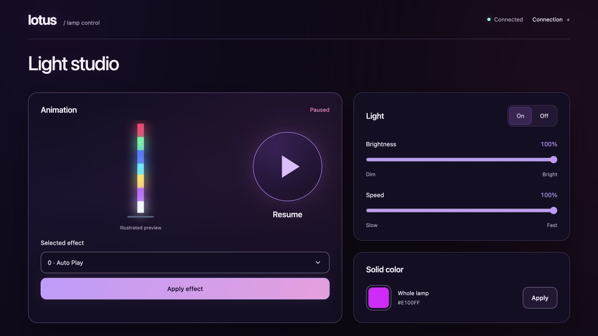
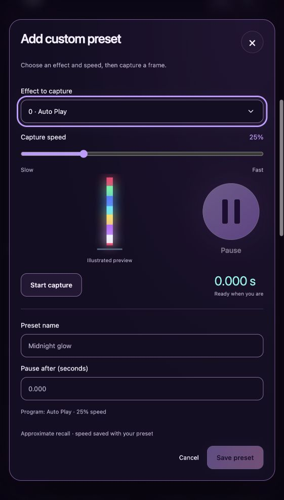

# Lotus Light Studio

A local Bluetooth control app for Lotus Lamp–compatible lights, with **Pause** at its heart.



## What you can do

- Control power, brightness, animation speed and whole-lamp RGB color.
- Browse 213 built-in programs in **Presets → Default**, with search, categories and illustrated previews.
- **Pause** an effect on a frame you like, then resume it.
- Create **Custom presets**: choose an effect and capture speed, pause, name and save. Replay automatically pauses after the saved time at the saved speed. Edit or delete recipes locally.



## Run on macOS

Requires Bluetooth and **Python 3.11+ or uv**.

```sh
git clone https://github.com/Biryukovlex/lotus-light-studio.git
cd lotus-light-studio
open "Launch Lotus Lamp.command"
```

Or double-click the launcher. Allow Bluetooth access, close the lamp's phone app, and connect at **http://127.0.0.1:8420**. Keep the terminal open; Ctrl+C stops the app and releases Bluetooth. First launch installs dependencies; the app then needs no cloud account or remote assets.

## Compatibility and limits

Tested on macOS with a **Tyute SSG-500 / MELK-OA10**. Other controllers need validation. Pause is experimental; timed preset recall is approximate, and previews illustrate effect families. Arbitrary segment colors, custom palettes and firmware flashing are not supported. [Setup and details](LOCAL_APP.md).

## Help extend it

Developers are welcome! Add controller support, improve effect previews, investigate the protocol, or extend the controls. Open an issue or pull request, and include your lamp model and test evidence. See the [developer guide](docs/DEVELOPMENT.md) and [protocol notes](docs/PROTOCOL.md).

Developed by [biryukovlex](https://github.com/Biryukovlex), built on [Wayne Porter's Lotus Lamp Python](https://github.com/wporter82/lotus-lamp-python). [MIT license](LICENSE).
